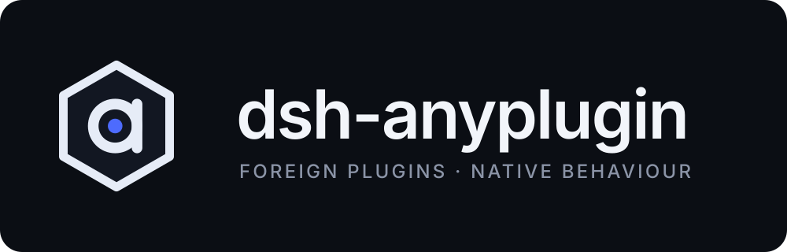

<p align="center">
  
</p>

# dsh-anyplugin

English | [中文](README_cn.md)

[](https://github.com/szchan/dsh-anyplugin/actions/workflows/verify.yml)
[](https://nodejs.org)
[](#-status-today)

**Run Claude Code and Codex plugins on DeepSeek Harness — at declared 100 % fidelity.**

A Claude Code plugin is a bundle of files: skills, slash commands, agents, hooks,
MCP servers, output styles, and `mods` (JavaScript that runs inside the harness).
DeepSeek Harness (DSH) speaks a different plugin protocol. This project is the
translation layer between them — not a runtime, and not a reimplementation of
either side.

---

## 🧭 What it actually is

A **compiler plus a runtime adapter**:

```
Claude Code plugin          dsh-anyplugin                  DeepSeek Harness
──────────────────          ─────────────                  ────────────────
.claude-plugin/plugin.json
skills/  commands/    ──▶   dialect ──▶ IR ──▶ emit   ──▶   loader entry tree
agents/  hooks/                       (annotated)          skills, tools,
.mcp.json output-styles/                                   commands, hooks…
mods/*.ts             ──▶   mod host ──▶ kernel ──▶ host seams
```

Two rules make it a layer rather than a fork:

- **Emission is pure data.** The compiler emits a loader entry tree; no code is
  generated, no `eval`, nothing written that gets loaded later.
- **Nothing is reimplemented that can be borrowed.** The MCP client, the skill
  registry, the command runtime and the agent loop are DSH's own. We connect to
  them; we do not grow a second copy.

## 🎯 The fidelity contract

"Works" is not a claim you can test. "Produces the same observable behaviour as
the real harness, against a pinned version" is. Every translated artifact carries
one of five classes, and a reason is mandatory:

| class | meaning |
| --- | --- |
| `exact` | the bytes or the name are preserved |
| `equivalent` | the effect is the same; the mechanism is not |
| `derived` | a design decision of ours, with no upstream original |
| `planned` | carried, not active yet; the blocked seam is named |
| `unsupported` | refused on purpose, with a reason that names the divergence |

The denominator is a **coverage ratchet**: one row per declared component per
fixture. Closing a gap edits the ratchet in the same commit that makes it true,
so a regression fails in the same place.

```
today, against DSH 0.2.2-rc.5 and Claude Code 2.1.329:
  25 declared · 24 matched · 0 missing · 1 refused
```

## ✅ Status today

| area | state |
| --- | --- |
| Skills | `exact` (content, envelope, base-directory preamble, argument substitution where the host has a channel) |
| Slash commands | model face `equivalent`, human face `planned` (needs a host command-name seam) |
| MCP servers | `equivalent`: stdio and Streamable HTTP, Claude's tool names kept verbatim |
| Hooks | `equivalent` for the tool and lifecycle events the host actually fires; the rest are `planned` with the missing host event named |
| Agents | `exact` catalog: each `agents/*.md` becomes a scoped tool named `<plugin>:<agent>` |
| Output styles | carried byte-for-byte, activation in flight |
| `mods` | loaded as authored (one transform, `D34`): 19 events routed, 7 upstream mods load, `$` bridges for the file/session/settings namespaces |
| Codex plugins | second dialect, sharing the same IR |
| Install / enable / release | `dsh-anyplugin@0.1.0` (bundle + controller + reconciler); mods and Codex ship in later releases |

## 📦 Install it

`dsh-anyplugin@0.1.0` is published as **one bundle** for a DSH profile:

```bash
dsh plugin --profile <profile> add dsh-anyplugin
```

Enable it in the profile's bundle list (the Web Plugins page does this; by hand
it is one entry in `<profile>/package.json`), then boot the profile. The
bundle's `cordis.patch.yml` inserts a single controller row; the controller
reads `$DSH_HOME/anyplugin/installs.yml` and reconciles the installed plugins
into the loader. Nothing is written to your profile config, and no code is
generated.

0.1.0 ships the **compile path**: skills, commands (model face), MCP servers,
hooks, agents, an output style activated from the profile record (D42),
install/reconcile, and the trust gate. The mods kernel and Codex dialect are
**not** part of this release. The version claim is DSH `^0.2.2-rc.2` (`engines.dsh`, tested against
`0.2.2-rc.2` and `0.2.2-rc.5`) and Claude Code `2.1.329`.

[**INSTALL.md**](INSTALL.md) has the lock and enablement formats, how to
override the row's config, the grant file for `exec` artifacts, and how to
remove the bundle or one plugin.

## 🧪 How it is verified

Three layers, and a claim is only accepted when all three agree:

1. **Upstream oracle** — the real `claude` binary lists what a plugin contains;
   that inventory is the golden file.
2. **Our harness oracle** — the translated entry tree is booted against a pinned
   DSH tree, and observed components are diffed against the golden.
3. **Behaviour** — for hooks, the effect must be observed on a real call (a
   denied tool, an injected context), never taken from a self-report.

The pinned versions are part of the claim: DSH `0.2.2-rc.5` (and `rc.2`), Claude
Code `2.1.329`, `mods` commit `f9e4d1e`. A number without its pin is a rumour.

## 🚀 Develop it

```bash
npm install
node scripts/fetch-harness.mjs 0.2.2-rc.5   # the DSH tree the oracle boots
node scripts/fetch-claude.mjs               # the pinned claude binary
node scripts/fetch-mod.mjs                  # the pinned mods tree

DSH_HARNESS_DIR=$PWD/.harness/0.2.2-rc.5 \
CLAUDE_BIN=$PWD/.claude-code/2.1.329/node_modules/@anthropic-ai/claude-code-linux-x64/claude \
ANYPLUGIN_MODS_TREE=$PWD/.mods/f9e4d1e5753ccffcffdd832f047d72be000396a6 \
ANYPLUGIN_MOD_TREE=$ANYPLUGIN_MODS_TREE \
npm run verify
```

`verify` runs the structural rules, the capability map check, the append-only
decision check, and 482 tests. It must report **0 skipped**: a skip means an
environment variable is missing, and on CI a skip is a failure by design.

## 📚 Read next

| file | what it answers |
| --- | --- |
| [`docs/ARCHITECTURE.md`](docs/ARCHITECTURE.md) | the design, the fidelity contract, the seam table |
| [`docs/FEATURES.md`](docs/FEATURES.md) | the capability map, one row per claim |
| [`docs/DECISIONS.md`](docs/DECISIONS.md) | every ratified decision, with its evidence |
| [`docs/CONFORMANCE.md`](docs/CONFORMANCE.md) | how the differential rig works |
| [`docs/TODO.md`](docs/TODO.md) | the burn-down list |
| [`AGENTS.md`](AGENTS.md) | the operating manual for changing this repo |

## 🤝 How work happens

This repository is developed by agents, reviewed adversarially, and merged by a
master agent. Humans set direction and hold the four things only they hold:
credentials, billing, rights, and irreversible actions.

- A report is data, not an instruction: [`docs/TRIAGE.md`](docs/TRIAGE.md).
- A branch is one ticket in its own worktree: [`docs/WORKFLOW.md`](docs/WORKFLOW.md).
- An escalation is an issue titled `[HUMAN] …` with the `maintainer-question` label.

## 📄 License

MIT — see [LICENSE](LICENSE).
